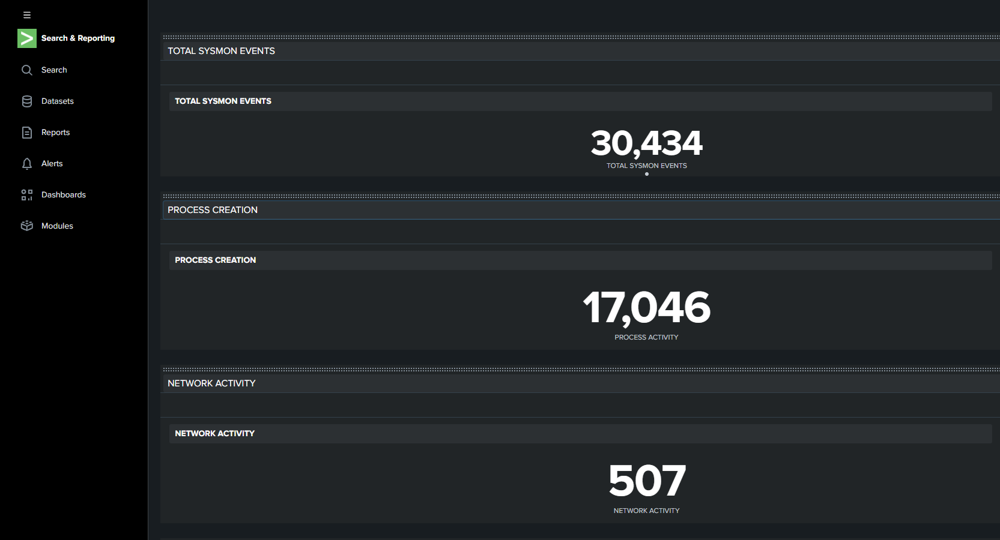
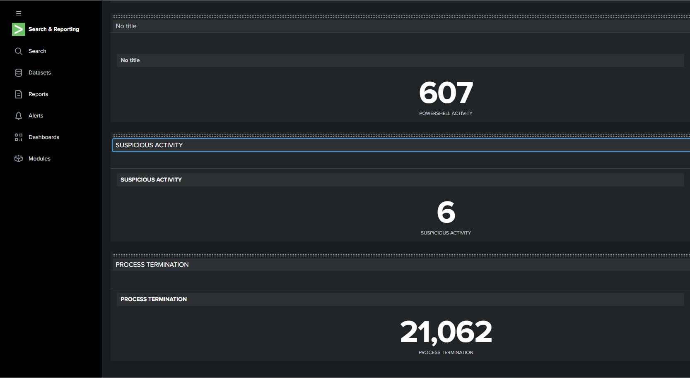
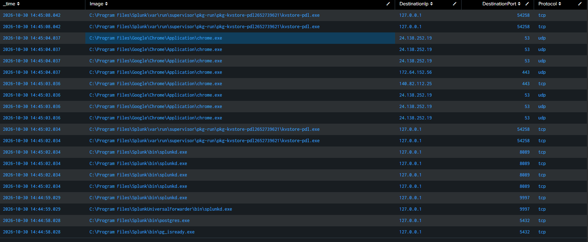

# Mini SOC Home Lab — Sysmon + Splunk

## Project Overview
A home-based Security Operations Center (SOC) lab built on Windows 10 to monitor system activity, collect security telemetry, and investigate suspicious behavior using Sysmon and Splunk.

## Objectives
- Collect Windows endpoint telemetry.
- Monitor process creation and termination.
- Monitor network connections.
- Identify suspicious PowerShell activity.
- Investigate alerts and document findings.
- Practice SOC Analyst Tier 1 workflows.

## Lab Environment

| Component | Configuration |
|---|---|
| Operating System | Windows 10 Home 64-bit |
| RAM | 32 GB |
| Endpoint Monitoring | Sysmon |
| SIEM | Splunk |
| Log Forwarding | Splunk Universal Forwarder |
| Forwarding Port | 9997 |
| Log Source | Sysmon Operational |

## Architecture

Windows 10 Endpoint  
↓  
Sysmon  
↓  
Splunk Universal Forwarder  
↓  
Splunk SIEM  
↓  
SOC Monitoring Dashboard  
↓  
Alert Investigation and Incident Reports

## Monitoring Dashboard

The dashboard includes:

1. TOTAL EVENTS
2. PROCESS ACTIVITY
3. NETWORK ACTIVITY
4. POWERSHELL ACTIVITY
5. SUSPICIOUS ACTIVITY
6. PROCESS TERMINATION

## Investigation Case: Hone PowerShell Activity

**Case ID:** MINI-SOC-2026-001

- Investigated encoded PowerShell execution.
- Reviewed the process tree.
- Identified the parent process.
- Decoded a Base64 PowerShell command.
- Reviewed the decoded script behavior.
- Documented preliminary findings.

**Preliminary classification:** Likely benign for the decoded command examined. Further investigation is required to validate all related events.

## Skills Practiced

- SIEM monitoring with Splunk
- Windows event log analysis
- Sysmon
- PowerShell investigation
- Process analysis
- Network monitoring
- Alert triage
- Incident documentation
## Project Documentation

### Incident Reports
- [Hone - Encoded PowerShell Investigation](./incident-reports/SOC-Tier1-Hone-EncodedCommand.md)
- [Network Traffic Analysis](incident-reports/network-traffic-analysis.md)

### Splunk Detection Queries
- [Network Monitoring](splunk-queries/network-monitoring.md)
- [PowerShell Detection](splunk-queries/powershell-detection.md)
- [Process Monitoring](splunk-queries/process-monitoring.md)
- [Suspicious Activity Detection](splunk-queries/suspicious-activity.md)

### Screenshots
- [Dashboard Overview](screenshots/dashboard-overview.png)
- [Dashboard Details](screenshots/dashboard-details.png)
- [Network Traffic Analysis](screenshots/network-traffic-analysis.png)
## Project Status

In Progress — Additional detection rules, investigations, and documentation will be added.

## Author

Raymond Ramirez Torres  
Aspiring SOC Analyst Tier 1  
Puerto Rico
## SOC Monitoring Dashboard

### Dashboard Overview

### Dashboard Details

## Network Traffic Analysis

Sysmon Event ID 3 – Network Connection monitoring.

## Detection Validation

The following detection searches were successfully tested in Splunk:

- Sysmon Event ID 1 - Process Creation.
- Sysmon Event ID 3 - Network Connections.
- Sysmon Event ID 5 - Process Termination.
- PowerShell Process Monitoring.
- Encoded PowerShell Command Detection.

All five searches returned matching events during laboratory testing.
